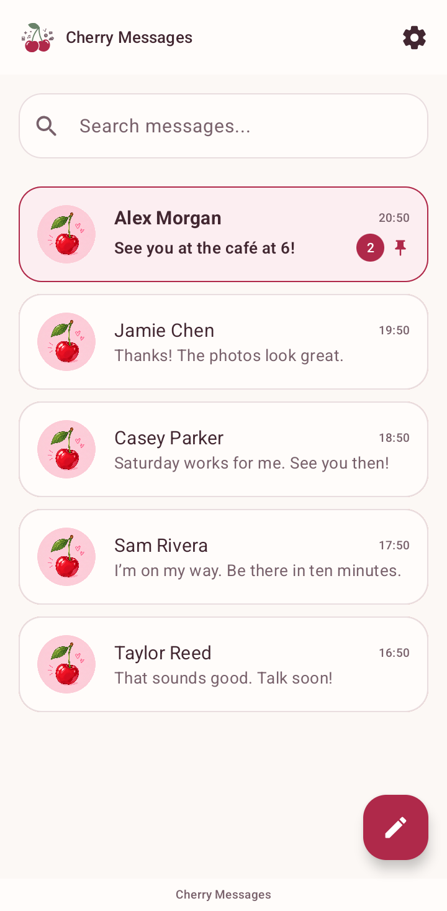
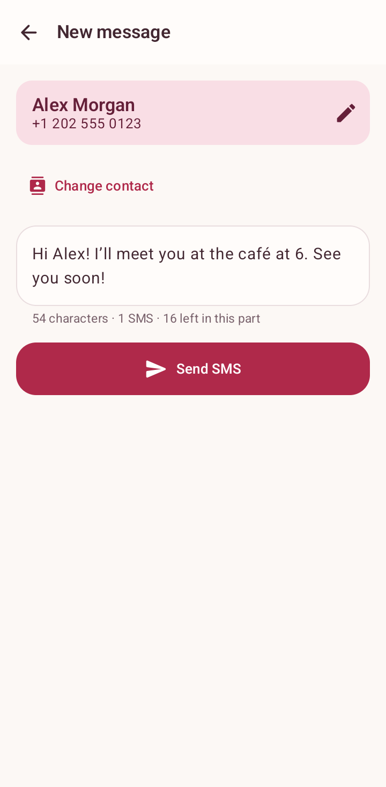
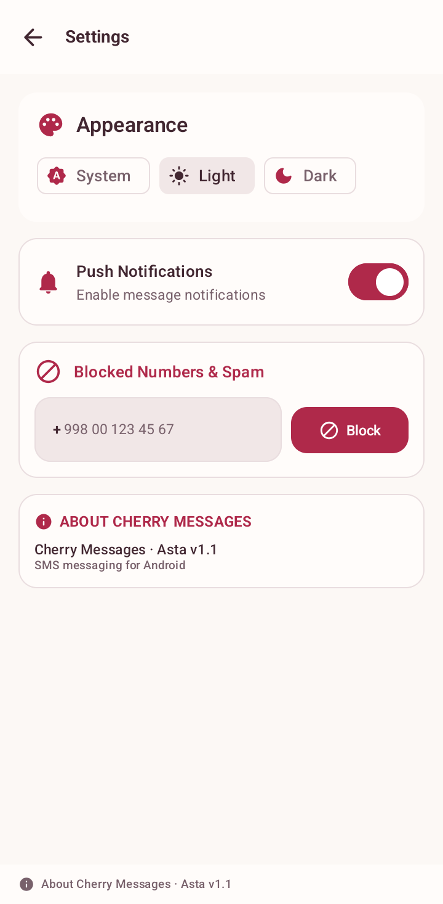

<div align="center">
  
  <h1>Cherry Messages</h1>
  <p><strong>Your messages, together.</strong></p>
  <p>A familiar Android SMS inbox with contact names, clear unread messages, and a softer cherry theme.</p>
  <p>
    
    
    
  </p>
  <p>
    <a href="#screenshots">Screenshots</a> ·
    <a href="#features">Features</a> ·
    <a href="#getting-started">Get started</a> ·
    <a href="https://github.com/asta-JC/Cherry-Messages/issues">Feedback</a>
  </p>
</div>

---

## Overview

Cherry Messages brings SMS saved on your phone into one inbox. Complete Android's default SMS app and permission prompts, open an existing conversation or choose a contact, and send through your SIM. Recipients can use their usual SMS app. Light, Dark, and System appearances keep the interface comfortable throughout the day.

## Screenshots

<table>
  <tr><th width="33%">Your inbox</th><th width="33%">Write a message</th><th width="33%">Make it yours</th></tr>
  <tr>
    <td align="center"></td>
    <td align="center"></td>
    <td align="center"></td>
  </tr>
  <tr><td align="center">See what is new.</td><td align="center">Know how many SMS parts you will send.</td><td align="center">Choose your appearance.</td></tr>
</table>

Captured from the production screen composables on a physical Samsung Galaxy S22 Ultra, in Light mode. Names, numbers, and conversations are demonstration data in an isolated test install; no personal messages are shown. System status and navigation bars are cropped out.

## Features

- **Existing SMS and contacts:** load SMS stored in Android's telephony database and display matching contact names after permission is granted.
- **Clear composing:** choose a contact with both name and number visible, or enter a number using the phone keyboard.
- **SMS length awareness:** live character, remaining-space, and part counters account for Unicode and emoji. Long text uses multipart SMS, with a limit of 10 parts per send in the composer.
- **Readable unread messages:** highlighted conversations and unread counts; chats open at the first unread message, and counts update as messages become visible.
- **Everyday navigation:** search conversation names, numbers, and previews; long-press a conversation to pin it. Screen changes have no sliding or zooming transition.
- **CherryApp appearance:** saved Light, Dark, and System modes, matching controls and icons, and the shared CherryApp header mark alongside the original launcher icon.

## Compatibility

| Area | Current behavior |
| :--- | :--- |
| Platform | Android 8.0 / API 26 or newer; compile and target SDK 37 |
| Sending | Carrier SMS through an active SIM and available service; SMS charges may apply, including per-part charges |
| Length | Encoding-dependent capacity, calculated by Android; up to 10 SMS parts per composer send |
| Message history | SMS exposed by Android's shared telephony provider; private RCS, WhatsApp, Telegram, and other app histories are not imported |
| Multimedia | MMS attachment sending/downloading and RCS are not implemented |
| Removal | Deleting a conversation removes its local cache; the original system SMS remains and may return on refresh |
| Delivery | Carrier callbacks update sending status; delivery reports depend on network support |

## Getting started

### Installation

The release APK uses the existing **debug/test signing certificate**, not a dedicated production signing key. Updates must use the same certificate as the installed app.

On first launch, follow the system prompts to make Cherry Messages the default SMS app and grant SMS/contact access. Existing SMS loads after setup. A working SIM and carrier service are needed to send; the recipient does not need Cherry Messages.

### Requirements

- A physical Android device running Android 8.0 or newer.
- Android SDK 37 and Android Studio compatible with Android Gradle Plugin 9.4.1.
- JDK 25, matching the pinned Gradle daemon toolchain; the app targets Java 11 bytecode.

### Build and run

```bash
git clone https://github.com/asta-JC/Cherry-Messages.git
cd Cherry-Messages
./gradlew :app:assembleDebug
adb -s DEVICE_SERIAL install -r app/build/outputs/apk/debug/app-debug.apk
```

Replace `DEVICE_SERIAL` with the intended physical phone's serial from `adb devices -l`. The `-r` flag preserves existing app data.

### Tests

```bash
./gradlew :app:testDebugUnitTest :app:assembleDebugAndroidTest
adb -s DEVICE_SERIAL install -r app/build/outputs/apk/androidTest/debug/app-debug-androidTest.apk
adb -s DEVICE_SERIAL shell am instrument -w \
  -e class com.asta.cherrymessages.SmsLengthTest \
  com.asta.cherrymessages.test/androidx.test.runner.AndroidJUnitRunner
```

The SMS-length device tests cover single-part boundaries, Unicode, emoji, extension characters, and the multipart cap without sending messages. For repeatable README captures, build with `-PreadmeScreenshots` and run `ReadmeScreenshotsTest` in the isolated `.screenshots` package. That test skips the normal app package and never seeds the user's message database.

## Built with

| Layer | Technology |
| :--- | :--- |
| Interface | Kotlin, Jetpack Compose, Material 3 |
| Navigation and state | Navigation 3, ViewModel, StateFlow, coroutines |
| Local storage | Room and SQLite FTS |
| Dependency injection | Hilt |
| SMS integration | Android SmsManager, Telephony provider, broadcast receivers |
| Background infrastructure | WorkManager |
| Build | Gradle 9.6.0, Android Gradle Plugin 9.4.1, SDK 37 |

## What's new in 1.1

- Existing-SMS setup, contact selection, and more accurate sending feedback.
- Softer light/dark styling, saved appearance choices, and simpler navigation.
- Unread highlighting, direct positioning at new messages, and read-count synchronization.
- Live SMS counters with encoding-aware multipart limits.

## Feedback

Report problems or suggest improvements in [GitHub Issues](https://github.com/asta-JC/Cherry-Messages/issues). Include the app version, Android/device version, and steps to reproduce. For SMS problems, say whether the failure concerns import, sending, receiving, or delivery status. Use sample text and hide phone numbers, contact names, and verification codes.

## License & credits

This project is developed as part of Asta's project series. Feel free to use and adapt for personal and educational use!

Android, Kotlin, Jetpack Compose, Material, Room, Hilt, and the other dependencies remain subject to their respective licenses. Original Cherry Messages artwork and CherryApp branding are preserved.

---

<p align="center">
  <strong>Made with ❤️ &amp; 🍒 by Asta</strong><br />
  <sub>Part of the CherryApp family.</sub>
</p>
