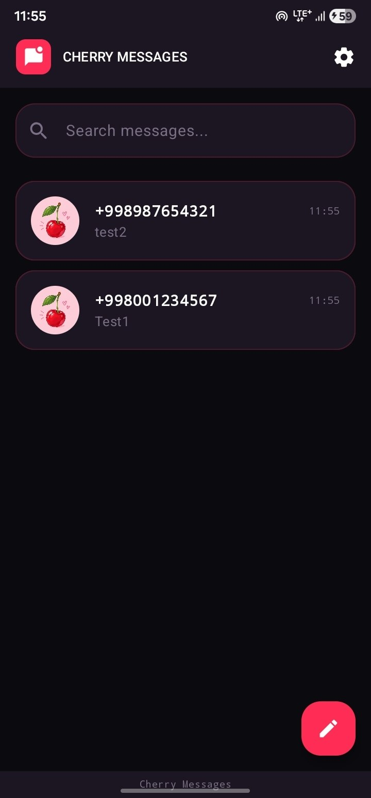
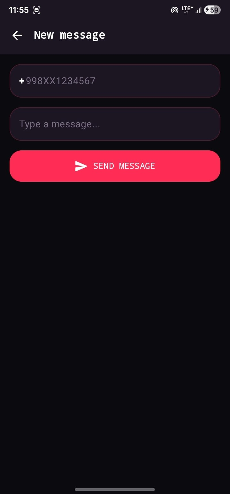
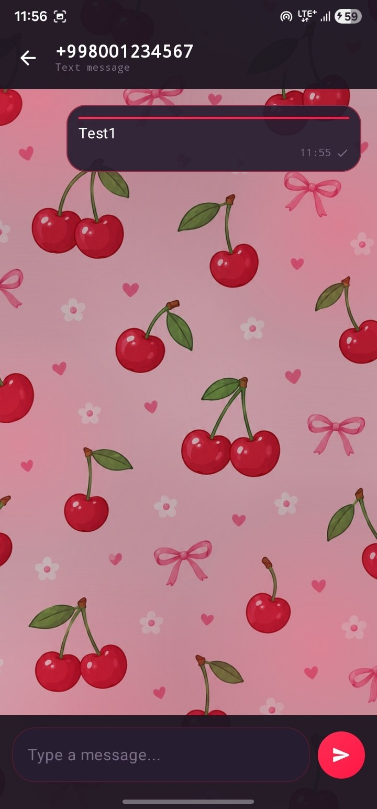
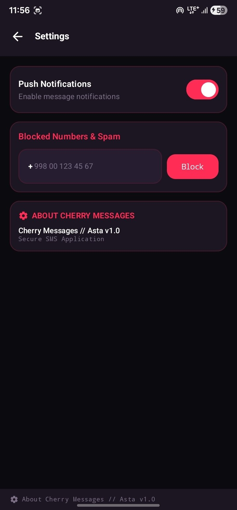

<div align="center">

# 🍒 Cherry Messages

<p align="center">
  
</p>

> A futuristic, high-performance, offline-first Android SMS & MMS messenger with vibrant cherry red accents and robust delivery queues. 💬✨

</div>

---

## 📱 Overview

**Cherry Messages** is a modern, privacy-focused Android SMS & MMS messenger built with Jetpack Compose and Material 3. Designed as a full default SMS application, it delivers lightning-fast full-text search, persistent conversation management, automated retry queues via WorkManager, and secure backup and restore capabilities.

---

## ✨ Key Features

- 🍒 **Cherry Red Futuristic Theme**: Immersive dark OLED theme featuring cherry red accents (`#FF2A55`), smooth transitions, and Material 3 components.
- ⚡ **Offline-First & High Performance**: Local database powered by **Room** with **FTS4 (Full-Text Search)** for instant message querying across massive conversation threads.
- 🛡️ **Default SMS App Compliance**: Fully compliant with Android's default SMS handler role (`Telephony.Sms`), enabling native SMS/MMS sending, receiving, broadcast receivers, and provider synchronization.
- 🔄 **Reliable Delivery Queue**: Background queuing and automatic retry mechanism for outgoing messages via **WorkManager** to ensure zero message loss even under weak connectivity.
- 🔐 **Secure Backup & Restore**: Export and import structured message backups directly using Android's Storage Access Framework (SAF).
- 💬 **Rich Conversation Management**: Thread detail views, contact search, attachment support, delivery status indicators, and notification management.

---

## 📸 Screenshots & UI Preview

| Conversation List | Chat Thread | Search & Filter | Settings |
| :---: | :---: | :---: | :---: |
|  |  |  |  |

---

## 🛠️ Tech Stack & Architecture

- **UI Toolkit**: [Jetpack Compose](https://developer.android.com/jetpack/compose) & [Material 3](https://m3.material.io/)
- **Architecture**: MVVM (Model-View-ViewModel) with Repository pattern and Unidirectional Data Flow
- **Dependency Injection**: [Hilt](https://dagger.dev/hilt/) (Dagger)
- **Concurrency**: Kotlin Coroutines & `StateFlow`
- **Local Storage**: Room Persistence Library with FTS4 full-text search
- **Background Tasks**: Android WorkManager for reliable message retry workers
- **Telephony**: Android `SmsManager`, `TelephonyProvider`, broadcast receivers (`SMS_RECEIVED_ACTION`, `WAP_PUSH_DELIVER`)

---

## 📂 Project Structure

```tree
com.asta.cherrymessages/
├── data/                   # Room database, DAOs, entities, and repositories
├── di/                     # Hilt dependency injection modules
├── receivers/              # SMS/MMS broadcast receivers & WAP push deliver
├── services/               # Background telephony & headless SMS services
├── ui/                     # Compose screens, components, conversation list, and theme
├── util/                   # Permissions, phone formatters, and notification helpers
├── workers/                # WorkManager background retry queues
├── CherryMessagesApp.kt    # Application class
└── MainActivity.kt         # Entry point activity & navigation host
```

---

## 🚀 Getting Started & Build Instructions

### Prerequisites
- Android Studio Ladybug or newer
- JDK 17 or higher
- Android SDK 26+ (Target SDK 34+)

### Build Steps

1. **Clone the repository**:
   ```bash
   git clone https://github.com/asta-JC/Cherry-Messages.git
   cd CherryMessages
   ```

2. **Open in Android Studio**:
   - Open Android Studio and select **Open**.
   - Navigate to the cloned `CherryMessages` directory and let Gradle sync.

3. **Build & Run**:
   - Connect an Android device or start an emulator.
   - Run the app via Android Studio or execute via terminal:
     ```bash
     ./gradlew :app:assembleDebug
     ```

4. **Default SMS App Configuration**:
   - Upon launch, accept system prompts to grant SMS permissions (`SEND_SMS`, `READ_SMS`, `RECEIVE_SMS`, `READ_CONTACTS`).
   - Accept prompt to set **Cherry Messages** as the device's Default SMS Application for full features.

---

## 📄 License

This project is developed as part of Asta's project series. Feel free to use and adapt for personal and educational use!

---

<p align="center">
  Made with ❤️ & 🍒 by Asta
</p>
